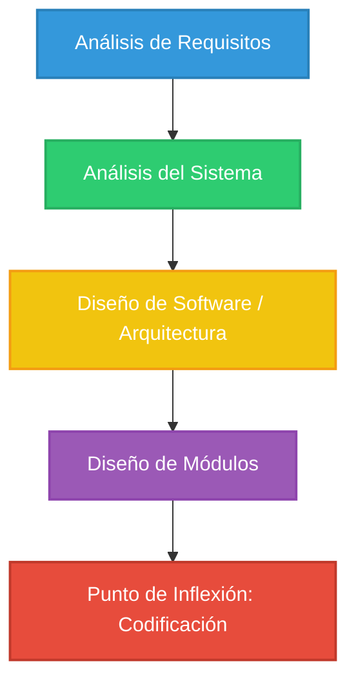

# Aplicación Web - Metodología de Desarrollo en V

Proyecto web desarrollado siguiendo las fases iniciales de la metodología en V solicitada.

---

## 📊 Infografía: Rama Descendente (Fase de Verificación)

---

## 🔽 Fases Descendentes de la Metodología

1. **Análisis de Requisitos (Requirement Gathering):** 
   * Definición de las necesidades del usuario y funcionalidades requeridas en el sistema.
2. **Análisis del Sistema (System Analysis):** 
   * Especificación del comportamiento general del software y la arquitectura funcional.
3. **Diseño de Software / Arquitectura (Software Design):** 
   * Definición de los componentes principales, interfaces y el stack tecnológico (Python, Django, Vite.js, Docker).
4. **Diseño de Módulos (Module Design):** 
   * Detalle de la lógica interna, algoritmos y modelo de datos para cada módulo.
5. **Punto de Inflexión: Codificación (Coding):** 
   * Construcción del código fuente y desarrollo efectivo del proyecto.

---

## 👥 Roles y Niveles de Acceso
- **Administrador:** Gestión total desde el panel Django Admin (`/admin`).
- **Gestor:** Administración de datos operativos y reportes.
- **Usuario:** Acceso a vistas privadas de usuario registrado.
- **Visitante:** Acceso a landing pública, login y registro.
